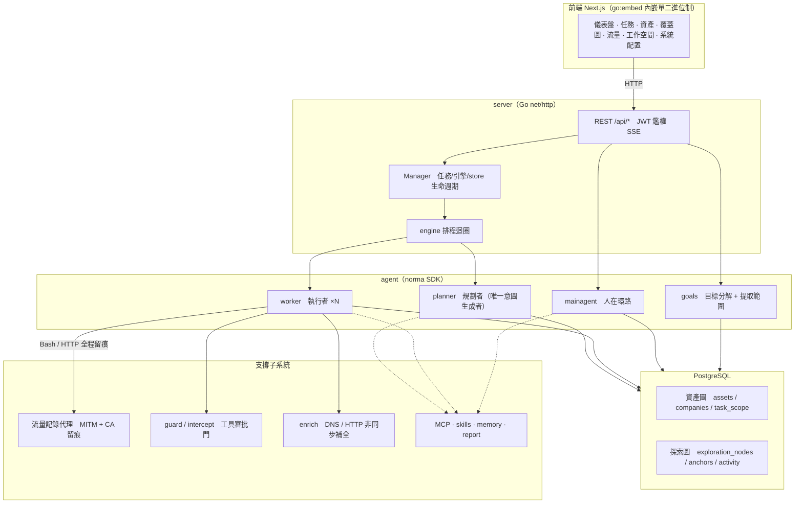
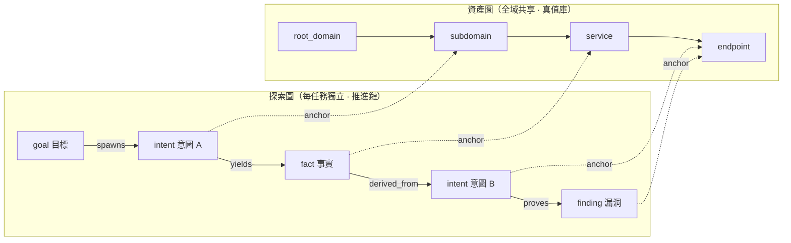
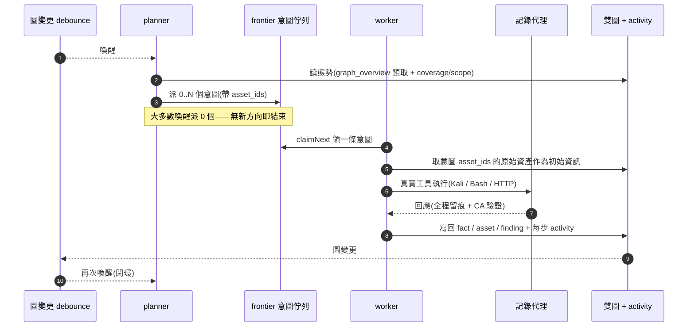
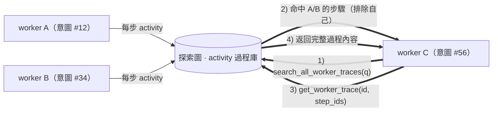
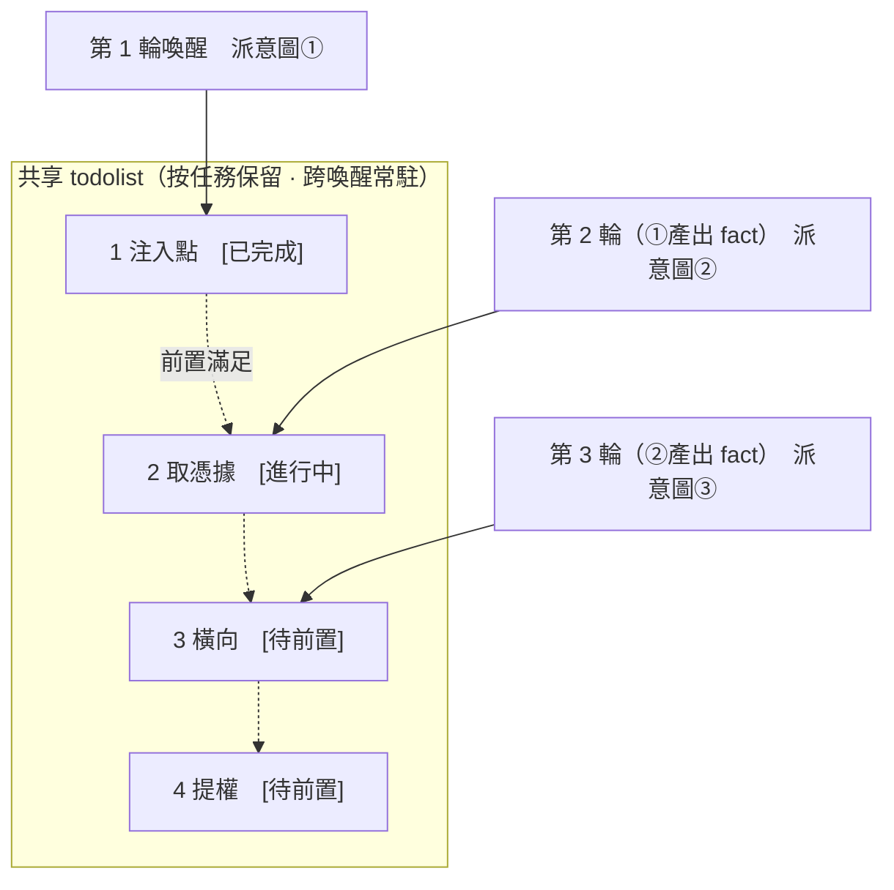

<div align="center">

# ARTEX

AI 自主滲透測試系統（Go 後端 + Next.js 前端）


🌐 **線上 Demo**： [https://artex-demo.vercel.app/](https://artex-demo.vercel.app/)

</div>

本儲存庫為獨立維護的 [RuoJi6/ARTEX](https://github.com/RuoJi6/ARTEX)，保留 https://github.com/Autumn-27/ARTEX 的原始提交歷史與 AGPL-3.0 許可證。程式釋出包從本儲存庫 Releases 下載，Docker 映像 [ruoji6/artex](https://hub.docker.com/r/ruoji6/artex) 由本儲存庫 GitHub Actions 構建並發布。

---

## 截圖預覽

> 完整互動見[線上 Demo](https://artex-demo.vercel.app/)。

| 儀表盤（總覽 / Token 消耗 / 活動流） | 任務列表 |
| :---: | :---: |
|  |  |

| 任務 · 執行過程（會話 / 工具呼叫） | 探索鏈路 |
| :---: | :---: |
|  |  |

| 發現 | 資產 |
| :---: | :---: |
|  |  |

| 資產覆蓋圖（力導向佈局 · 已測高亮 · 節點摺疊展開） |
| :---: |
|  |

| 流量錄製 | 人在環路對話 |
| :---: | :---: |
|  |  |

| Agent 管理 | LLM 配置 |
| :---: | :---: |
|  |  |

| 攔截審批 | 後端日誌 |
| :---: | :---: |
|  |  |


---

## 審批記錄詳情

全域「審批記錄」、任務內「攔截審批」及對話中的審批卡片均支援展開檢視詳情。展示結構參考
[AegisHook 的審批詳情元件](https://github.com/RuoJi6/AegisHook/blob/main/web/src/components/CallDetail.vue)，沿用 ARTEX 的元件和主題：


## 資產同步（ScopeSentry）

支援從 [ScopeSentry](https://github.com/Autumn-27/ScopeSentry) 直接同步資產資料，免去重複收集：

- 在「**資產同步**」頁填 ScopeSentry 的地址與 API Key，接入資料來源；
- 按**專案**或**任務**維度選擇要同步的目標與資產型別（域名 / 子域 / IP / 埠 / 站點 / 端點…）；
- 一鍵匯入並按公司資產範圍歸併，直接進入 ARTEX 的資產圖供 agent 探索使用。

---

## 安裝

> 依賴資料庫 **PostgreSQL**；探索需配置 **LLM**（`ANTHROPIC_API_KEY` 或 `OPENAI_API_KEY`，也可在 UI 裡配）。

### 方式一：一鍵安裝指令碼（推薦）

```bash
git clone https://github.com/RuoJi6/ARTEX.git
cd ARTEX
./install.sh
```

指令碼會：檢測 / 自動安裝 Docker → 讓你選 **① 全部 Docker** 或 **② 本地編譯執行**：

- **① 全部 Docker**：填一個 Postgres 密碼（可回車隨機）→ 自動寫 `.env` → `docker compose up -d`。
- **② 本地執行**：選資料庫（連已有 / 用 Docker 起一個）→ 生成 `config.json` → `go` 編譯內嵌單二進位制 → 啟動。

裝好後開啟 **http://localhost:8787**（首次進入 `/setup` 設定管理員密碼）。

### 方式二：Docker Compose（手動）

```bash
git clone https://github.com/RuoJi6/ARTEX.git
cd ARTEX
cp .env.example .env          # 填 POSTGRES_PASSWORD、可選 ANTHROPIC_API_KEY
docker compose up -d          # 拉取 ruoji6/artex 映像 + postgres
# → http://localhost:8787
```

映像已含常用工具（ripgrep/curl/vim/npm/nmap…）；`./skills` 與 `./data` 以綁定掛載持久化。

`.env` 中預設 `ARTEX_IMAGE=ruoji6/artex`，`ARTEX_TAG=latest` 使用最新映像，也可固定為 `v0.3.17`（完整映像地址 `ruoji6/artex:v0.3.17`）。映像支援 `linux/amd64` 和 `linux/arm64`，Docker 會自動選擇與宿主機匹配的架構，ARM64 Kali 無需自行編譯。初次部署請修改 `POSTGRES_PASSWORD`；執行服務無需配置 Docker Hub 釋出 Token。

遠端 MCP 可在系統設定中選擇 `http`（Streamable HTTP）或 `sse`（舊版 SSE）。
舊版 SSE 服務通常使用 `GET /sse` 建立事件流，再通過服務返回的
`/message?sessionId=...` 接收 JSON-RPC 請求；配置時將 URL 填為 `/sse`，請求頭按
`Authorization=Bearer <token>` 填寫。

### 方式三：下載預編譯二進位制（Releases）

到本儲存庫的 [Releases](https://github.com/RuoJi6/ARTEX/releases) 下載對應平臺的 zip，解壓後得到 `artex` + `start.sh`（Windows 為 `start.bat`）+ `skills/` + `config.example.json`。Linux ARM64（包括 ARM64 Kali）選擇 `linux-arm64`，x86_64 選擇 `linux-amd64`：

```bash
cp config.example.json config.json   # 填好 database 連線
./start.sh                           # → http://localhost:8787
```

> 請用 `start.sh` / `start.bat` 啟動，而不是直接跑 `./artex`。它是個守護指令碼：程式退出後按退出碼決定是否重新拉起，**頁面上的[一鍵更新](#方式一頁面一鍵更新推薦)靠它完成換裝**。直接執行 `./artex` 時更新完就不會被拉起了。
> 後臺常駐：`nohup ./start.sh >artex.log 2>&1 &`。

### 方式四：從原始碼編譯單二進位制

```bash
# 1) 前端靜態匯出
cd web && npm ci && npm run build:static && cd ..
# 2) 拷進內嵌目錄
cp -r web/out server/webui/dist
# 3) 編譯（-tags embedui 才內嵌前端）
CGO_ENABLED=0 go build -tags embedui -o artex ./cmd/artex
./start.sh
```

### 方式五：構建跨平臺 Release 壓縮包

`build.sh` 會先構建並嵌入前端，再使用 Go linker 去除除錯資訊，並將釋出檔案壓縮為 zip。Release 模式預設生成 Linux amd64/arm64、macOS amd64/arm64 和 Windows amd64 的 zip 包：

```bash
./build.sh --release
# 產物：dist/artex-0.3.3-*.zip
```

UPX 自解壓二進位制可能與部分 Linux 核心、虛擬化環境或安全策略不相容，因此預設不啟用。可用 `ARTEX_TARGETS` 自定義目標；確認目標執行環境相容時，可顯式傳入 `--upx` 進一步縮小二進位制：

```bash
ARTEX_TARGETS=linux/amd64,windows/amd64 ./build.sh --release
./build.sh --target linux/amd64 --upx
```

---

## 更新升級

> 升級只換程式、不動資料：Postgres 資料卷 `pgdata`、`./data`（jwt.key / SQLite 等）、`./skills` 都會保留。**資料庫遷移無需手動執行**——`artex` 每次啟動會冪等重跑 `schema.sql`（含 `ADD COLUMN` / `CREATE INDEX IF NOT EXISTS`），即“重啟即遷移”。升級前仍建議先備份 `./data` 與資料庫。

### 方式一：頁面一鍵更新（推薦）

在 **系統配置** 頁（側邊欄「系統配置」→ `/system/settings`）的**版本與更新**卡片裡，可以直接檢查並安裝新版本，無需登入伺服器。

本儲存庫構建的程式固定從 `RuoJi6/ARTEX` 的最新正式 GitHub Release 檢查更新，跳過草稿和預釋出版本。舊版官方程式仍指向原作者儲存庫，因此首次切換必須手動安裝本儲存庫構建的程式；以後釋出更高的三段式版本即可通過頁面升級。僅推送 main 或 Git 標籤但未釋出 Release，不會產生可線上安裝的新版本。

點「更新」後：下載當前平臺的釋出包 → 比對 Release 的 `SHA256SUMS` → 用 `-h` 冒煙測試新二進位制 → 暫存為 `artex.new` → 程式退出，由 `start.sh` / `start.bat` 重新拉起並完成換裝。頁面會自動等到新版本上線後重新整理。

- **失敗不會留下壞程式**：校驗或冒煙不通過就丟棄暫存件、繼續跑當前版本；換裝後的新版若連續 3 次啟動失敗，會自動回滾到 `artex.old`（失敗的那個留作 `artex.failed` 供排查）。
- **隨時可回退**：上一版本保留為 `artex.old`，卡片上有「回滾到上一版本」。注意資料庫結構不會回退。
- **更新會中斷正在執行的任務**——更新即重啟，請在空閒時進行。
- **開發構建不給更新**：版本號是 `dev` 或 `git describe` 帶字尾時停用，避免正式版覆蓋掉本地除錯的二進位制。
- **Docker 下只換程式、不換映像**：映像裡的 playwright / nmap 等工具鏈不會跟著升級，且 `docker compose up -d` 重建容器後會退回映像自帶的版本。要連映像一起升級仍請用 `docker compose pull artex && docker compose up -d artex`。
- 訪問 GitHub 需要代理時，在同一頁面配置**全域代理**即可，更新鏈路會走它。更新只從 GitHub 域名下載並強制 HTTPS。

### 維護者：通過 GitHub Actions 釋出線上更新

釋出工作流為 `.github/workflows/release.yml`。推送正式標籤會觸發構建，也可在 Actions → release → Run workflow 中輸入已存在的標籤重新執行失敗的釋出。標籤必須是 `v主版本.次版本.修訂號`，例如下例的 `v0.3.17`；後續版本必須高於使用者正在執行的版本。

```bash
git push origin main
git tag v0.3.17
git push origin v0.3.17
```

工作流固定標籤對應的提交，用 Node.js 22 匯出前端，按照 `go.mod` 指定的 Go 版本編譯內嵌前端的五個平臺程式，並生成 ZIP 與 `SHA256SUMS`。AMD64 和 ARM64 映像分別在 GitHub 原生 runner 上構建，連線臨時 PostgreSQL 驗證程式啟動、版本和內嵌前端；兩種架構都通過後釋出多架構映像的版本標籤與 `latest`。映像釋出成功後上傳完整 ZIP 和校驗檔案，最後公開 Release。已公開的同版本不允許覆蓋，應釋出新標籤。

維護者需在本儲存庫 Settings → Secrets and variables → Actions 中配置變數 `ARTEX_DOCKER_IMAGE`（Docker Hub 使用者名稱/映像名）和 Secrets `DOCKERHUB_USERNAME`、`DOCKERHUB_TOKEN`（有映像推送權限）。程式包通過 GitHub 自帶 `GITHUB_TOKEN` 上傳，映像通過上述憑據推送到 Docker Hub。憑據只供工作流登入使用，不寫入原始碼或映像。映像地址同時記錄在 `.env.example` 和 Compose 預設值中。

### 已有 Docker 部署遷移到本儲存庫映像

在原部署目錄中備份 `.env`、Compose 檔案、`data/` 和 PostgreSQL 資料，保留原資料庫卷和 skills 掛載。將 `.env` 的 `ARTEX_IMAGE` 設定為本儲存庫映像地址、`ARTEX_TAG` 設定為目標版本；如果舊 Compose 仍寫死原作者的映像，可建立下列覆蓋檔案（已有覆蓋檔案時應合併 image 配置）：

```yaml
# docker-compose.override.yml
services:
  artex:
    image: ${ARTEX_IMAGE}:${ARTEX_TAG:-latest}
```

然後只更新應用容器：

```bash
docker compose pull artex
docker compose up -d --no-deps artex
curl --fail http://127.0.0.1:8787/api/health
docker compose logs --tail=50 artex
```

繼續使用原部署目錄和 Compose 專案名稱，確保 `./data`、`./skills` 和 PostgreSQL 資料卷仍指向原資料。遷移後程序從 `RuoJi6/ARTEX` 檢查線上更新；後續可用頁面更新程式或上述命令更新整個映像。

首次遷移已有 Docker 部署時，將已校驗的新 ARM64 ZIP 解壓到宿主機，備份原程式，然後只替換已有容器中的 `/app/artex`。例如現有容器名為 `artex-artex-1`：

```bash
# 在下載目錄執行；先按 SHA256SUMS 核對下載的 ZIP，再解壓。
sha256sum --ignore-missing --check SHA256SUMS
unzip artex-0.3.17-linux-arm64.zip
sudo docker stop artex-artex-1
sudo docker cp artex-artex-1:/app/artex ./artex-before-migration
sudo docker cp ./artex-0.3.17-linux-arm64/artex artex-artex-1:/app/artex
sudo docker start artex-artex-1
curl --fail http://127.0.0.1:8787/api/health
```

這會保留現有資料庫、data 和 skills 掛載。登入系統配置頁檢查更新源與版本。容器內替換的程式仍屬於容器可寫層，刪除或重建容器會丟失替換結果；需要重建時應使用包含本儲存庫程式的映像。程式回滾不回退資料庫遷移，升級前請備份資料庫和 data。

### 方式二：一鍵更新指令碼

```bash
cd ARTEX
./update.sh
```

指令碼先可選 `git pull` 拉取最新程式碼，再讓你選 **① Docker 更新** 或 **② 本地編譯更新**（與 `install.sh` 對應）：

- **① Docker**：可指定目標映像 tag（回車沿用 `.env` 的 `ARTEX_TAG`，預設 `latest`）→ `docker compose pull` → `docker compose up -d`（換新映像重啟即自動遷移）。
- **② 本地**：重建前端靜態產物 → 重新編譯 `./artex`（完成後重啟程序生效）。

### 方式三：Docker Compose（手動）

```bash
cd ARTEX
git pull                       # 更新 compose / 指令碼（可選）
# 指定版本：在 .env 設 ARTEX_TAG=v0.3.17；不設則用 latest
docker compose pull artex
docker compose up -d artex     # 換新映像重啟 → 自動遷移 schema
docker image prune -f          # 清理舊映像（可選）
```

### 方式四：預編譯二進位制（Releases）

到 [Releases](https://github.com/RuoJi6/ARTEX/releases) 下載新版本 zip，停掉舊程序後覆蓋 `artex` 與 `skills/`（保留你的 `config.json` 與 `data/`），重啟即可：

```bash
cp -r <解壓目錄>/skills ./ && cp <解壓目錄>/artex ./
./start.sh
```

### 方式五：從原始碼編譯

```bash
git pull
cd web && npm ci && npm run build:static && cd ..
cp -r web/out server/webui/dist
CGO_ENABLED=0 go build -tags embedui -o artex ./cmd/artex
# 重啟 ./start.sh
```

---

## 配置

**資料庫**（`config.json`，或用環境變數 `ARTEX_PG_DSN` 覆蓋）：

```json
{
  "database": {
    "host": "127.0.0.1", "port": 5432,
    "user": "artex", "password": "yourpass",
    "dbname": "artex", "sslmode": "disable"
  }
}
```

**LLM**：`export ANTHROPIC_API_KEY=sk-...`（或 `OPENAI_API_KEY`），也可在 UI 的「LLM 配置」頁填寫。
可選：`ARTEX_LLM_PROVIDER` / `ARTEX_LLM_MODEL` / `ARTEX_LLM_BASE_URL` / `ARTEX_LLM_PROXY`。

**併發**：每個任務的 work agent 數在「系統設定」裡配置（預設 3）。

**常用引數**：`./start.sh -addr :8787 -proxy :8788`（`-addr` 前端+API，`-proxy` 流量錄製代理）。啟動指令碼會把引數原樣透傳給 `artex`。

### 可選的 HTTP Basic Auth 訪問驗證

在 **系統配置 → HTTP Basic Auth** 中填寫獨立的驗證使用者名稱和密碼，開啟「啟用訪問驗證」並點選「儲存訪問驗證」。預設關閉，儲存後立即生效，無需重啟；密碼至少 8 位、最多 72 位元組，使用者名稱不能包含冒號。

開啟後，訪客先完成瀏覽器原生帳號密碼驗證，再進入原有 ARTEX 登入頁。網頁、靜態資源和 API 均受保護，`/api/health` 健康檢查保留公開訪問；通過訪問驗證仍需登入 ARTEX 才能使用業務 API。公網部署請通過 HTTPS 訪問。

配置持久化到資料庫，密碼僅儲存 bcrypt 雜湊，介面不會回顯。儲存時密碼留空表示不修改；關閉後保留憑據，方便再次開啟。獨立的 HttpOnly 驗證 Cookie 有效期為 12 小時，相容現有 JWT 和 SSE；儲存配置會使其他瀏覽器的舊驗證 Cookie 失效，當前管理員瀏覽器保持訪問。瀏覽器可能快取 Basic Auth 憑據，可用新的無痕視窗檢查驗證彈窗。

Docker 和內嵌前端二進位制直接支援此功能。`next dev` 的認證檢查僅向本機迴環後端轉發憑據（`localhost`、`127.0.0.1` 或 `::1`）；前端與後端應使用同一主機名。遠端開發後端未開啟驗證時仍可使用；開啟後請通過內嵌前端訪問遠端服務，避免跨域驗證 Cookie 問題。

若遺忘獨立驗證密碼，可在伺服器連線應用資料庫後執行以下語句並重啟 ARTEX，關閉這層訪問驗證，再用原有 ARTEX 帳號登入後重新配置：

```sql
UPDATE settings
SET value = jsonb_set(value::jsonb, '{enabled}', 'false'::jsonb)::text,
    updated_at = now()
WHERE key = 'auth.http_basic';
```

### 反向代理部署（HTTPS / 只開放 443）

前端和 API/SSE 都由同一個後端埠（預設 `:8787`）提供，即時活動流預設走**同源**地址，因此**無需配置 `NEXT_PUBLIC_SSE_BASE`**，公網只開放 443、把 8787 留在內網即可。

SSE 是長連線 + 持續推送，反代**必須關閉緩衝**，否則瀏覽器能連上卻收不到事件（表現為活動流一直轉圈）。Nginx 示例：

```nginx
server {
    listen 443 ssl;
    server_name your.domain.com;
    # ssl_certificate / ssl_certificate_key ...

    location / {
        proxy_pass http://127.0.0.1:8787;
        proxy_set_header Host $host;
        proxy_set_header X-Forwarded-Proto $scheme;

        # SSE 關鍵項：關緩衝、長超時、HTTP/1.1
        proxy_buffering off;
        proxy_cache off;
        proxy_read_timeout 3600s;
        proxy_http_version 1.1;
        proxy_set_header Connection "";
    }
}
```

> 僅當 SSE 需要走與頁面不同的來源（如獨立子域）時，才在**構建期**設定 `NEXT_PUBLIC_SSE_BASE`（該變數在 `next build` 時固化進靜態包，容器執行時再設無效）。

---


## 開發

### 同一漏洞歸併與統一報告

發現頁預設「按漏洞」。原始上報、按任務及按資產保留原來的表格、狀態和操作按鈕，僅已歸併記錄改為可展開的漏洞資料夾。同一任務內，Reporter 依據目標、介面引數、權限邊界、根因及驗證證據確認同一實際缺陷後形成資料夾；僅型別或名稱相同不會作為自動歸併依據。嚴重程度、介面、後端或讀寫影響不同仍可能是同一漏洞；反之，共用登入入口或令牌不能單獨證明同一根因。有關聯但共同根因無法確認時提交人工建議。資料夾的 `嚴/高/中/低` 數量按原始記錄統計，例如 `0/1/1/1`；發現頁的獨立漏洞數按資料夾去重，等級數量按原始上報統計，列表及資料夾詳情不顯示統一評級標籤。原始上報內容、評級、狀態、報告及證據不被覆蓋。

點選箭頭展開原始記錄，點選資料夾標題檢視統一報告、原始記錄及歸併歷史。證據不足的建議需要點選「確認歸併」；否決或移出後，這些關係不會被 Agent 自動再次歸併。移出成員不刪除原漏洞，不足兩條時解散資料夾並保留歷史。繼承任務的漏洞組保持只讀。

新上報由現有 Reporter 生成獨立報告並檢查重複。升級首次補充 Reporter 的歸併工具和執行指引，保留自定義提示詞及觸發設定；已刪除或停用的 Reporter 不會重建、啟用。歷史記錄不會自動掃描：展開並選擇原始記錄，點選「整理所選」，按任務分別排隊執行，可檢視執行記錄及失敗資訊。同一任務已有排隊或執行中的整理時拒絕重複提交。歷史整理以只讀方式複用原報告，禁止覆蓋原報告或補綁證據；已有報告為空或過期時如實說明，單獨通過報告撰寫流程處理。結束前需提交每條所選記錄的根因判斷，檢查讀取範圍、建議、統一報告完整性及版本，通過驗收才顯示完成。資料夾詳情可重新生成統一報告；需要啟用 Reporter 並配置可用模型。判斷和寫作會消耗模型 token，候選檢索先分頁返回摘要，詳情證據按需讀取，不重新探測目標。

成員、報告或證據變化後統一報告標記待更新，寫入時校驗實際讀取版本。匯出預設每組一份統一報告及未歸併記錄，可勾選「包含原始子報告」；統一報告未生成或過期時附明確說明及全部原始材料。原始上報顯示所屬任務、資產及時間；按任務先展開任務，再展開漏洞資料夾；按資產保留資產樹，命中任一成員即展示整個資料夾，展開時標明未命中篩選的成員。摺疊狀態只讀取輕量摘要，不載入成員報告。升級沿用啟動時冪等資料庫遷移，無需執行獨立 SQL。

### 手動漏洞複測

任務詳情的「複測」頁籤可分頁選擇本任務的漏洞、檢視歷次結論和證據，並手動發起複測。啟動後保留當前頁籤，顯示轉圈圖示和「複測中」；確認修復後同步更新漏洞狀態。

在漏洞列表每行操作區點選「複測」，或在漏洞詳情的「漏洞複測」區域點選「發起複測」，填寫可選的修復版本、測試條件或限制，系統會建立獨立的複測 Agent 會話，啟動後保留當前頁面。列表的平鋪、按任務分組和資產檢視均支援該入口；複測執行時顯示轉圈圖示和「複測中」，需要檢視時點選進入對應會話，結束後恢復「複測」。複測無需重新啟動原掃描任務，結論分為「仍可重現」「已修復」「無法確認」，每次的結論、證據和會話連結儲存在漏洞詳情中。

新版後端首次啟動會預置可編輯的「漏洞複測」（`retester`）Agent，可在 Agent 管理中配置提示詞、LLM、執行預算和工具。預設使用其綁定的 LLM，未綁定則使用全域啟用配置。複測會話成功完成且結論為「已修復」時，系統自動將漏洞處置狀態改為「已修復」；執行中、失敗、停止或其他結論保留原狀態。原始證據和報告始終保留。也可在狀態下拉選單中手動選擇「已修復」。同一漏洞正在複測時複用已有會話，停止、失敗或服務重啟後可重新發起。

本版歷史記錄通過漏洞詳情和會話檢視，暫未納入漏洞報告匯出或任務歸檔包，也未自動關聯流量包。演示模式只生成明確標註的模擬記錄，不請求真實目標。

### 本地執行與測試

```bash
./dev.sh    # 後端(:8787) + 流量代理(:8788) + 前端 next dev(:5173) → http://localhost:5173
```

- 後端：`go run ./cmd/artex`（不帶 `-tags embedui` 則不內嵌前端）
- 前端：`cd web && npm run dev`（`/api` 反代到後端，帶熱更新）
- 測試：`go test ./...`
- Mock 預覽（無後端）：`cd web && NEXT_PUBLIC_MOCK=1 npm run dev`

---

## 系統技術架構

ARTEX 是一套 **LLM 多 agent 驅動的自主滲透系統**：Go 單體後端（內嵌 Next.js 前端）+ PostgreSQL，agent 能力由 [`norma`](https://github.com/Autumn-27/norma) SDK 提供（`agentcore` / `tool` / `permission` / `harness` / `memory` / `transcript`）。核心是**雙圖架構**，以及圍繞它的兩條自主性機制：**worker 間過程級資訊交換**與 **planner 多輪共享 todolist 穩定攻擊鏈路**。

### 總體分層



| 層 | 職責 |
| --- | --- |
| **前端** | Next.js 靜態匯出，`go:embed` 內嵌進單二進位制；視覺化任務/資產/探索鏈路/覆蓋圖，人在環路對話 |
| **server** | `net/http` 路由 + JWT 鑑權 + SSE；`Manager` 託管任務、引擎、DB store 的生命週期 |
| **engine** | 每任務一個 `plannerLoop` + N 個 worker goroutine；意圖領取、超時/暫停/drain |
| **agent** | goals / planner / worker / mainagent，`ToolSet` 把雙圖暴露成 LLM 工具 |
| **db** | 雙圖的 Postgres 落地（pgx）；schema 隨 `go:embed` 每次啟動冪等建表 |
| **支撐** | 記錄型 MITM 代理、審批門、非同步補全、MCP/技能/記憶/報告 |

### 雙圖架構：探索圖 + 資產圖

系統把「**目標是什麼**」和「**測到了什麼程度**」拆成兩張相互獨立、又通過錨點相連的圖：

- **資產圖（Asset Graph，全域共享）**：跨任務同一份的資產真值庫。節點為 `root_domain / subdomain / ip / service / app / endpoint`，歸屬公司；域名→子域→服務→端點的父子關係與去重 key 全部由程式計算，agent 只提交原始資訊。
- **探索圖（Exploration Graph，每任務獨立）**：一次任務的“思考與推進”過程。節點為 `goal（目標）/ intent（意圖）/ fact（事實）/ finding（漏洞）/ hint（提示）`，靠 `spawns / derived_from / yields / proves` 等邊連成**血緣鏈**，回答“哪個方向派生自哪些事實、產出了什麼”。
- **兩圖靠錨點相連**：`exploration_anchors(node_id, asset_id)` 把意圖/事實/漏洞錨定到具體資產上——於是既能從“探索方向”看它打的是哪些資產，也能從“某個資產”反查它在本任務被哪些意圖測過、得出過哪些事實。這也支撐了**資產測試覆蓋度**與**資產覆蓋圖**（範圍內資產 + 已測高亮）。



> 分工：**planner** 讀探索圖態勢、判目標、只在有未覆蓋的新方向時派**意圖**進 frontier；**worker** 領**一條意圖**、用真實工具執行、把新資產/事實/漏洞寫回兩圖後即停。資產圖是共享事實，探索圖是每任務的推進鏈。

### 引擎與意圖生命週期（一次探索的閉環）

引擎是**事件驅動**的閉環：圖一變就喚醒 planner，planner 派意圖，worker 領意圖執行並寫回，寫回又觸發下一輪——直到目標被證明（`prove_goal`）。



### worker 間的過程級資訊交換

一次深入的探索裡，很多有價值的觀察（某個報錯、某段回應、某個隱藏引數）出現在一個 worker 的**執行過程**中，卻未必被寫成正式 fact。為避免重複勞動、讓鏈路上的 worker 能站在彼此的肩膀上，worker 具備**跨 work 檢索過程**的能力：

- `search_all_worker_traces(q)`：在**本任務其他 work 的執行過程**裡按關鍵字檢索（自動排除自己這條意圖的步驟），命中項帶 `intent_id`；
- `list_worker_traces` / `get_worker_trace(intent_id, step_ids=[…])`：先看有哪些 work 跑過，再取某個 work 具體幾步的完整內容做細節交換。

這樣即便探索圖上還沒有對應的 fact，後續 worker 也能複用他人過程中的觀察——**資訊在 worker 之間以“執行過程”為粒度流動**，而邊界不變（每個 worker 仍只做自己領到的那條意圖）。



### planner 多輪共享 todolist → 穩定的攻擊鏈路

真實攻擊鏈往往是**有前後依賴的多步序列**（如：發現注入點 → 拿到憑據 → 橫向 → 提權），一次性把這些並行派下去只會亂套。planner 因此持有一份**按任務保留、跨喚醒共享的規劃待辦（todolist）**：

- planner 是事件驅動的——圖一變就被喚醒，但**每次喚醒是全新會話**；共享的 todolist 讓它把一條序列利用鏈**記錄一次**、然後在後續多輪裡**按依賴逐步派意圖**，而不是把整條鏈在一輪裡全部前置展開；
- 每輪只對「前置步驟已完成、其依賴的 fact 已存在」的下一步派意圖，並隨進展更新清單（把已被 fact 滿足的步驟標完成）。



於是攻擊鏈在“事件驅動 + 無狀態會話”的環境下依然**穩定推進、不重複、不錯序**——這是 ARTEX 能自主走完多步利用鏈的關鍵。

---

## 交流群

掃碼關注微信公眾號 **SecSentry**，在公眾號後臺私信即可入群交流。

<div align="center">


</div>

---
## 參考

https://github.com/oritera/Cairn


## 許可與免責宣告

### 開源協議

本專案採用 **GNU Affero General Public License v3.0（AGPL-3.0）** 授權，完整條款見儲存庫根目錄的 [LICENSE](LICENSE) 檔案。

這意味著任何人都可以自由使用、修改和分發本專案，但**衍生作品必須同樣以 AGPL-3.0 開源**；特別地，**若你修改本專案並通過網路（如部署為線上服務）向使用者提供，也必須向這些使用者公開對應的完整原始碼**。

> ⚠️ **重要提示**：開源協議本身不限制軟體的使用用途。以下的「使用限制」與「免責宣告」是作者對使用者的額外約定與鄭重宣告，請務必遵守。

**ARTEX 僅供個人學習、程式碼研究與本地技術驗證使用，不得用於對任何線上系統或網站發起實際測試。**

### 允許使用範圍

- 僅可用於**閱讀、學習與研究本專案原始碼**，以及在**本地隔離環境**中進行技術原理驗證；
- 適用於個人學習、學術研究、程式碼審閱等非攻擊性用途。

### 禁止事項

- **嚴禁使用本工具對任何網站、線上服務或聯網系統發起掃描、探測、利用或攻擊**（無論是否獲得授權、是否為自有資產）；
- 嚴禁將本工具用於任何實際的滲透測試、攻防對抗或生產環境；
- 嚴禁將本工具用於非法入侵、資料竊取、勒索、拒絕服務或任何破壞性、犯罪性活動；
- 嚴禁利用本工具從事違反所在國家/地區法律法規的行為。

### 合規責任

使用者須自行遵守所在國家/地區關於網路安全、資料保護與計算機犯罪的全部法律法規（在中國大陸包括但不限於《網路安全法》《資料安全法》《個人資訊保護法》及相關司法解釋）。**因使用本工具產生的一切法律責任與後果，均由使用者自行承擔。**

### 免責宣告

本專案按“現狀（AS IS）”提供，不附帶任何明示或默示的擔保。作者及貢獻者不對使用本工具（無論使用方式是否得當）所導致的任何直接或間接損失、資料丟失、系統損壞或法律糾紛承擔責任。**下載、安裝或使用本專案，即表示你已閱讀、理解並同意上述全部條款。**
