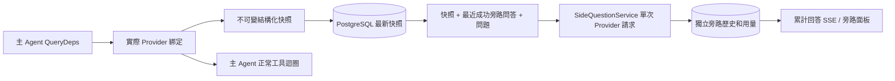

# ARTEX `/btw`

普通聊天、任務 MainAgent 和當前任務自己的 Worker 支援獨立旁路提問。主輸入框輸入 `/btw 問題` 即可提交，空 `/btw` 或“旁路提問”按鈕開啟歷史。桌面使用可調整寬度的側欄，移動端使用 Drawer。

旁路回答根據提交時的 Agent 上下文快照生成，支援流式顯示、追問、停止和清空。關閉面板、重新整理頁面或斷開 SSE 都不會取消模型請求。停止隻影響當前旁路；清空會取消旁路並刪除旁路歷史，同時保留主上下文快照。

## 實現邊界

沿用 Go、norma v0.3.7、Next.js、現有 Markdown / ResizablePanel / Drawer / AlertDialog 元件；沒有修改 norma 原始碼或為旁路新增依賴。Planner、繼承自其他任務的 Worker、工具型子任務升級不在本次範圍內。

- `capture.go` 只在 `Options.Deps.CallModel / CallModelSync` 標記主迴圈請求。Provider 裝飾器位於具體模型內部、路由池外層選擇之後，因此記錄實際選中的模型；壓縮和摘要請求不覆蓋快照。
- 請求開始、完整模型回覆、執行終態釋出快照。正在生成的半段回覆不釋出；工具呼叫通過 norma 的 `MessagesForAPI` 保持配對，工具結果在下一次主模型請求或執行終態進入快照。流式中止保留上一個有效邊界。
- 快照通過 JSON 深複製保留結構化訊息、系統提示、工具定義及生成引數。模型推理不持有快照鎖或資料庫事務。
- `SideQuestionService` 呼叫具體 Provider；必要時先生成旁路摘要，最終回答僅在首次上下文超限且尚未輸出文本/工具呼叫時允許縮減後重試一次。不建立 agent session，不接入工具執行器、主 transcript、活動流或任務圖，也不經過任務模型切換鏈。回答保留工具定義是為相容既有結構化工具上下文；摘要請求不提供工具。新返回的工具呼叫沒有執行路徑。
- 每個父會話一個執行請求，單個服務程序最多四個，單次超時 120 秒。旁路使用服務生命週期下的獨立取消上下文。
- 旁路請求保留模型配置引用和非敏感身份摘要；請求時從現有配置取得憑據。配置被刪除，或模型、協議、地址等身份欄位變化，要求先執行主 Agent 更新快照。測試不會改變產品預設模型。

## 持久化和恢復

`db/schema.sql` 自動建立 `side_question_sessions` 和 `side_question_requests`。前者儲存父資源、最新快照、執行編號、版本和清理版本；後者儲存問題、累計回答、狀態、模型、快照時間、用量、事件序號和分頁序號。

父會話鍵使用 conversation ID，或 task ID + exploration ID + intent ID。Worker 不使用可複用的執行槽位命名。

快照按父會話合併寫入，每 250 ms 重新整理一次，資料庫比較 `(run_id, version)` 防止舊版本覆蓋。旁路提交前再次儲存選定快照。成功儲存後釋放記憶體中的大快照；失敗時保留待寫版本。回答累計內容在流式事件到來時最多每 250 ms 寫入一次，終態立即儲存並在資料庫錯誤時有限重試。

服務啟動將遺留 `running` 請求標記為 `interrupted`，保留已落庫的部分回答和用量，不自動重放請求。最近成功儲存的上下文可直接用於下一次提問。舊會話沒有快照時要求先執行主 Agent，不從 UI 活動記錄重建上下文。

清空操作遞增清理版本並刪除請求；條件更新阻止遲到的回撥重新寫回。物理父資源刪除依靠外部索引鍵級聯，Worker 邏輯刪除在同一事務中刪除旁路資料，並拒絕後續遲到快照。任務歸檔先阻止新請求、等待主流程停止、取消並等待旁路落庫；歸檔格式為 v3，同時相容不含旁路表的 v1/v2。

歷史完整儲存，按序號游標每頁最多返回 20 條。模型請求最多回放最近 20 組成功問答原文，同時按 token 預算限制回放量；較舊問答維護獨立滾動摘要。主上下文超預算時僅摘要旁路副本的舊部分，保留近期結構化工具呼叫與結果。摘要、準備進度與用量一起納入旁路的併發、取消和 120 秒超時限制。詳見 [上下文預算與開源參考](CONTEXT_BUDGET.md)。

## HTTP 契約

以下路徑作為 `{parent}`，沿用現有認證及資源校驗：

- `/api/conversations/{id}`
- `/api/tasks/{id}/chat`
- `/api/tasks/{id}/intents/{iid}`

| 請求 | 返回及行為 |
| --- | --- |
| `GET {parent}/side-questions?before={ordinal}` | `items` 按新到舊排列、獨立 `current` 執行狀態、`snapshot` 元資訊、`next_cursor`；游標為 0 表示最新頁 / 無下一頁 |
| `POST {parent}/side-questions` | JSON `{ "question": "…", "client_request_id": "UUID" }`；新請求返回 202 及請求物件；相同 ID 和問題返回既有物件 200 |
| `DELETE {parent}/side-questions` | 取消並清空當前父會話的旁路問答 |
| `GET /api/side-questions/{requestID}/events` | `snapshot` SSE 事件，`id` 為遞增序號，`data` 為完整累計請求物件；清空時傳送 `cleared` |
| `POST /api/side-questions/{requestID}/cancel` | 顯式取消；終態可從歷史或 SSE 讀取 |

問題上限 4000 字元。無快照、模型配置變化、同一父會話忙或冪等 ID 衝突返回 409；全域併發上限返回 429。每次 SSE 連線都先發送累計狀態，不依賴客戶端之前收到的文本片段。前端按請求 ID + 序號合併，並在切換父會話、清空時廢棄舊回撥。

## 驗證與參考

自動化檢查、實際模型使用及已知限制見 [VALIDATION.md](VALIDATION.md)。

獨立請求參考 [Grok CLI side-question.ts（固定提交）](https://github.com/superagent-ai/grok-cli/blob/fb97af83f06dca873281d60168430f06c8de6324/src/utils/side-question.ts)，執行隔離參考 [OpenCode（固定提交）](https://github.com/anomalyco/opencode/tree/b3f1a96c6dd7adeb28b36dd11add1998fc84d67b)。ARTEX 的上下文使用 norma 的結構化訊息，未採用從前端日誌拼接文本的方式。
