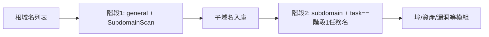

---

## name: scopesentry-mcp
description: 通過 ScopeSentry MCP 管理安全掃描平臺（專案、任務、模板、資產、節點）。在使用者提到 ScopeSentry、MCP、API Key、掃描任務、資產查詢時使用。

# ScopeSentry MCP 使用指南

面向**已部署 ScopeSentry 例項**的使用者。通過 Cursor（或其他 MCP 客戶端）連線平臺，無需本地原始碼。

## 1. 準備工作

### 1.1 確認服務可訪問

- 預設 Web 介面：`http://<主機>`
- MCP 端點：`http://<主機>/mcp`（若前面有反向代理或前端代理，以實際 `/mcp` 地址為準）

### 1.2 建立 API Key

1. 瀏覽器登入 ScopeSentry Web 介面
2. 進入 **API Key** 管理頁建立金鑰（或通過管理員提供的介面建立）
3. 儲存返回的 `ssk_...` 字串（**僅顯示一次**）

### 1.3 配置 Cursor MCP

Cursor → Settings → MCP → 新增伺服器：

```json
{
  "mcpServers": {
    "scopesentry": {
      "url": "http://<你的主機>:8082/mcp",
      "headers": {
        "X-API-Key": "ssk_你的金鑰"
      }
    }
  }
}
```

也可使用：`Authorization: Bearer ssk_你的金鑰`

配置完成後重啟 MCP 或過載 Cursor，確認工具列表中出現 `list_projects`、`list_assets` 等。

---

## 2. 工具一覽


| 工具                     | 用途                |
| ---------------------- | ----------------- |
| `list_projects`        | 按標籤分組的專案樹（含專案 ID） |
| `list_projects_data`   | 分頁專案列表，可按名稱搜尋     |
| `get_project`          | 專案詳情              |
| `create_project`       | 新建專案              |
| `list_tasks`           | 掃描任務列表            |
| `get_task`             | 任務詳情              |
| `list_scan_templates`  | 掃描模板列表            |
| `get_scan_template`    | 模板詳情              |
| `list_plugin_modules`  | 掃描流水線模組名          |
| `list_plugins`         | 可用外掛（含 hash、預設引數） |
| `create_scan_template` | 建立掃描模板            |
| `create_scan_task`     | 建立掃描任務            |
| `list_assets`          | 查詢各類資產（分頁列表）       |
| `count_assets`         | 統計資產數量（`/api/assets/common/total`） |
| `get_asset_detail`     | 資產或漏洞詳情           |
| `add_asset_tag`        | 為資產新增標籤           |
| `list_nodes`           | 掃描節點列表            |


各工具引數以 MCP 工具描述（schema）為準；`list_assets` / `count_assets` 的 search、filter 語法一致，查詢資產前可先閱讀 `list_assets` description。

需要知道「共多少條」時用 `count_assets`（對應 Web 分頁總數介面），不必為了數總數反覆翻頁 `list_assets`。

---

## 3. 常用工作流

### 3.1 按專案查資產

當使用者或上下文**已有專案條件**時，優先帶上 `filter.project` 縮小範圍，避免跨專案資料過多導致回應變慢。若無明確專案，可不強制加專案篩選。

1. `list_projects` 或 `list_projects_data` 獲取目標專案的 **ObjectID**（`id` / `children[].value`）
2. `list_assets` 傳入 `filter.project`（**必須是 ID，不能寫專案中文名**）

```json
{
  "asset_type": "asset",
  "pageIndex": 1,
  "pageSize": 20,
  "search": "domain=^example.com",
  "filter": {
    "project": ["<專案ObjectID>"]
  }
}
```

### 3.2 建立掃描任務

1. `list_nodes` 獲取線上節點名稱
2. `list_scan_templates` 或 `create_scan_template` 獲取模板 **ObjectID**
3. `create_scan_task`：`name`、`node` 必填，`template` 填模板 ID（不能填模板名）

**目標來源 `targetSource`（與 Web 端一致）：**

| targetSource | 說明 | 必填引數 |
| --- | --- | --- |
| `general` | 直接輸入目標 | `target` |
| `project` | 從專案讀取目標 | `project`（專案 ObjectID 陣列） |
| `asset` | 從 Web 資產庫搜尋 | `search`；可選 `project`、`filter`、`targetNumber` |
| `RootDomain` | 從根域名庫搜尋 | `search`；可選 `project`、`filter`、`targetNumber` |
| `subdomain` | 從子域名庫搜尋 | `search`；可選 `project`、`filter`、`targetNumber` |
| `UrlScan` | 從 URL 掃描結果搜尋 | `search`；可選 `project`、`filter`、`targetNumber` |
| `*Source`（如 `subdomainSource`） | 從資產頁「選中/搜尋」建立 | `targetTp=search` 時用 `search`；`targetTp=select` 時用 `targetIds` |

**示例 — 直接掃根域名：**

```json
{
  "name": "example-子域名收集",
  "node": ["node-1"],
  "template": "<模板ObjectID>",
  "targetSource": "general",
  "target": "example.com\nfoo.com",
  "project": ["<專案ObjectID>"]
}
```

**示例 — 從子域名庫續掃（按上一任務名篩選）：**

```json
{
  "name": "example-埠與漏洞",
  "node": ["node-1"],
  "template": "<後續模組模板ObjectID>",
  "targetSource": "subdomain",
  "search": "task==\"example-子域名收集\"",
  "project": ["<專案ObjectID>"]
}
```

### 3.3 根域名完整資訊收集（推薦兩階段）

當輸入為**根域名**且要進行**完整資訊收集**時，建議分兩次掃描，不要一次跑全流水線。

**原因：** 分散式任務以**單個目標**為單位分發。根域名作為目標時，某節點分到該根域名後，在該節點上掃出的子域名也會繼續在該節點執行後續模組，容易造成負載不均、速度慢、易出錯。

**最佳實踐：**

1. **第一階段 — 僅子域名收集**
   - `targetSource`: `general`
   - `target`: 所有根域名（多行）
   - 模板：僅啟用 `SubdomainScan`、`SubdomainSecurity`（子域名掃描 + 子域名接管）
   - 用 `get_task` 等待任務完成

2. **第二階段 — 後續模組**
   - `targetSource`: `subdomain`
   - `search`: `task=="<第一階段任務名稱>"`（精確匹配任務名）
   - 可選 `project` 縮小範圍
   - 模板：埠掃描、資產測繪、漏洞掃描等（可不含 SubdomainScan）
   - 子域名作為獨立目標分發到各節點，並行效率更高

也可在 Web 介面「子域名」資產頁按任務名篩選後，使用「從子域名建立任務」，效果相同。



### 3.4 建立掃描模板

1. `list_plugin_modules` → 模組名列表
2. `list_plugins`（可按 `module` 過濾）→ 各外掛 `hash` 與預設 `parameter`
3. `create_scan_template`：用 `modules` 指定「模組 → 外掛 hash 陣列」

---

## 4. 資產查詢（`list_assets` / `count_assets`）

`count_assets` 與 `list_assets` 使用相同的 `asset_type`、`search`、`filter`，返回 `{ "total": N }`，對應 Web 端 `/api/assets/common/total`。

```json
{
  "asset_type": "subdomain",
  "search": "task==\"某任務名\"",
  "filter": {"project": ["<專案ObjectID>"]}
}
```

**效能建議（`list_assets` / `count_assets` 通用）：** 有專案條件時優先用 `filter.project` 縮小範圍；`search` 中對已建索引欄位儘量用 `==` 全等或 `^` 字首匹配（見 [4.3](#43-search-搜尋表示式)），避免大面積 `=` 模糊查詢拖慢回應。無專案上下文時不強制加專案篩選。

支援 `filter.project` 的型別見 [4.4](#44-filter-精確過濾) 表格。

### 4.1 資產型別 `asset_type`

`asset`、`RootDomain`、`subdomain`、`app`、`mp`、`UrlScan`、`SensitiveResult`、`DirScanResult`、`crawler`、`vulnerability`、`PageMonitoring`、`IPAsset`、`SubdomainTakerResult`

別名示例：`web`→asset、`vuln`→vulnerability、`ip`→IPAsset、`url`→UrlScan

### 4.2 引數說明


| 引數                       | 說明                                      |
| ------------------------ | --------------------------------------- |
| `pageIndex` / `pageSize` | 分頁，預設 1 / 20                            |
| `search`                 | 搜尋表示式（見下節）                              |
| `filter`                 | 精確過濾 JSON（見下節）                          |
| `sort`                   | 僅 UrlScan、DirScanResult 支援按 `length` 排序 |
| `sid`                    | 僅 SensitiveResult：敏感規則名稱                |


`search` 與 `filter` **可同時使用**。

### 4.3 search 搜尋表示式

自定義 DSL（**不是 SQL**）：


| 運算子  | 含義   | 索引 | 示例                          |
| ---- | ---- | ---- | --------------------------- |
| `=`  | 模糊匹配（regex） | 不走索引 | `domain=example`            |
| `==` | 精確匹配（全等） | **走索引** | `port==443`                 |
| `!=` | 排除   | — | `port!="80"`                |
| `&&` | 與    | — | `domain==example.com && port==443` |
| `||` | 或    | — | `title=admin || body=login` |


**索引與運算子：** `domain`、`ip`、`port`、`title` 等欄位已建索引，但僅 **`==` 全等** 或 **值以 `^` 開頭的字首匹配**（如 `domain=^example.com`）能走索引；**`=` 會轉為 regex 模糊匹配，無法使用索引**，資料量大時易變慢。

**所有型別通用 search 欄位：** `tag`、`task`（任務名稱）、`rootDomain`

**project 不能寫在 search 裡**（無效或與 `&&` 組合時報錯）。篩專案請用 `filter.project`。

**各型別常用 search 欄位：**


| asset_type           | 欄位                                                                                  |
| -------------------- | ----------------------------------------------------------------------------------- |
| asset                | domain, ip, port, service, app, title, statuscode, icon, banner, type, body, header |
| RootDomain           | domain, icp, company                                                                |
| subdomain            | domain, ip, type, value                                                             |
| app                  | name, icp, company, category, description, url, apk                                 |
| mp                   | name, icp, company, category, description, url                                      |
| UrlScan              | url, input, source, resultId, type                                                  |
| SensitiveResult      | url, sname, body, info, md5                                                         |
| DirScanResult        | url, statuscode, redirect, length                                                   |
| vulnerability        | url, vulname, matched, request, response, level                                     |
| crawler              | url, method, body, resultId                                                         |
| PageMonitoring       | url, hash, diff, response                                                           |
| IPAsset              | ip, domain, port, service, webServer, app                                           |
| SubdomainTakerResult | domain, value, type, response                                                       |


**search 示例：**

- `domain==www.example.com && port==443`（全等，走索引）
- `domain=^example.com`（字首匹配，走索引）
- `ip==192.168.1.1`
- `task=="某任務名"`
- `level==high`（vulnerability）
- `statuscode==200`（DirScanResult）

需模糊包含時再用 `=`，如 `title=admin`（不走索引，宜配合專案等條件縮小範圍）。

### 4.4 filter 精確過濾

JSON 物件：同 key 多個值為 **OR**，不同 key 為 **AND**。

**有專案條件時優先用 `project`：** 若使用者或上下文已明確專案，且 asset_type 支援 `project`，應帶上以縮小範圍；無專案資訊時不強制。


| filter key   | 含義       | 取值說明                                                     |
| ------------ | -------- | -------------------------------------------------------- |
| `project`    | 所屬專案     | **ObjectID**，用 `list_projects` / `list_projects_data` 獲取 |
| `task`       | 來源任務     | **任務名稱**，用 `list_tasks` 的 `name`                         |
| `port`       | 埠       | 如 `"443"`                                                |
| `service`    | 服務/協議    | 如 `"https"`                                              |
| `app`        | 應用指紋     | 如 `"Nginx"`                                              |
| `icon`       | 圖示 hash  |                                                          |
| `statuscode` | HTTP 狀態碼 | 主要用於 asset                                               |
| `status`     | 狀態       | UrlScan/DirScan HTTP 碼；漏洞/敏感資訊處理狀態                       |
| `level`      | 漏洞等級     | critical / high / medium / low / info                    |
| `type`       | 型別       | 如子域名記錄型別 A、CNAME                                         |
| `color`      | 敏感規則顏色   | SensitiveResult                                          |
| `sname`      | 敏感規則名    | SensitiveResult                                          |
| `tags`       | 標籤       |                                                          |


**各型別可用 filter key：**


| asset_type                            | filter key                                                      |
| ------------------------------------- | --------------------------------------------------------------- |
| asset                                 | project, port, service, app, icon, statuscode, type, task, tags |
| RootDomain                            | project, tags                                                   |
| subdomain                             | project, type, task, tags                                       |
| app / mp                              | project, tags                                                   |
| UrlScan                               | status, tags                                                    |
| DirScanResult                         | status, tags                                                    |
| SensitiveResult                       | status, color, sname, tags                                      |
| crawler                               | project, task, tags                                             |
| vulnerability                         | project, level, status, task, tags                              |
| PageMonitoring / SubdomainTakerResult | tags                                                            |
| IPAsset                               | project, port, service, app                                     |


**filter 示例：**

```json
{"project": ["<專案ObjectID>"], "port": ["443"]}
```

**組合查詢示例：**

```json
{
  "asset_type": "asset",
  "search": "domain=^baidu && port==443",
  "filter": {"project": ["<專案ObjectID>"]},
  "pageIndex": 1,
  "pageSize": 10
}
```

**注意：**

- 有專案條件時優先帶 `filter.project`（支援時）；無專案上下文可不強制
- `filter.project` 勿填專案顯示名稱
- 已知值用 `==`，字首用 `^`；避免對大表濫用 `=` 模糊匹配
- UrlScan 的 HTTP 狀態用 `filter.status`；DirScanResult 可在 search 中用 `statuscode==200`
- SensitiveResult 按規則名：`search` 用 `sname=規則名`，或 `filter.sname`

### 4.5 排序 sort

僅 **UrlScan**、**DirScanResult** 支援：

```json
{"length": "ascending"}
```

其他型別忽略 `sort`，按時間預設排序。

---

## 5. 掃描模板模組名

`TargetHandler`、`SubdomainScan`、`SubdomainSecurity`、`PortScanPreparation`、`PortScan`、`PortFingerprint`、`AssetMapping`、`AssetHandle`、`URLScan`、`WebCrawler`、`URLSecurity`、`DirScan`、`VulnerabilityScan`、`PassiveScan`

---

## 6. 故障排查


| 現象        | 處理                                                 |
| --------- | -------------------------------------------------- |
| MCP 無工具   | 檢查 URL、API Key、ScopeSentry 是否執行                    |
| 401 / 403 | 重新建立或更換 API Key                                    |
| 資產查不到     | 確認 `filter.project` 為 ObjectID；勿在 search 寫 project |
| 模板/任務建立失敗 | `template` 必須是模板 ObjectID；`node` 填線上節點名            |
| 查詢很慢/卡住   | 有專案時加 `filter.project`；search 對已索引欄位改用 `==` 或 `^` 字首，少用 `=`；縮小 `pageSize` |


---

